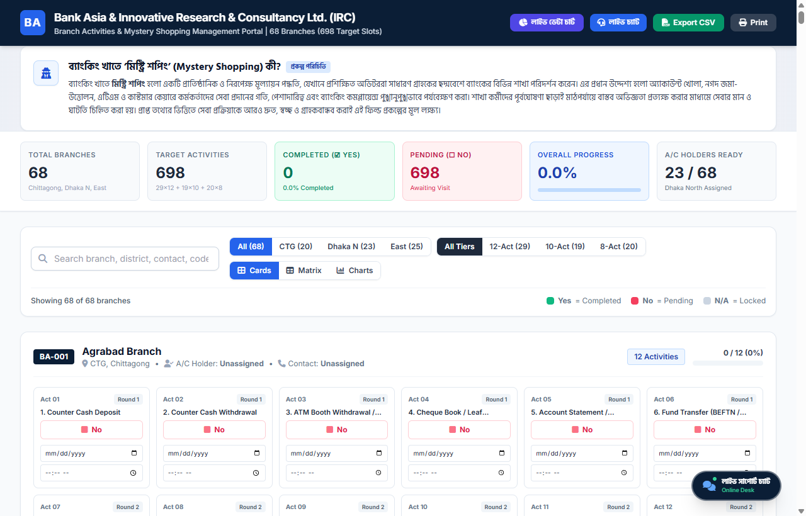
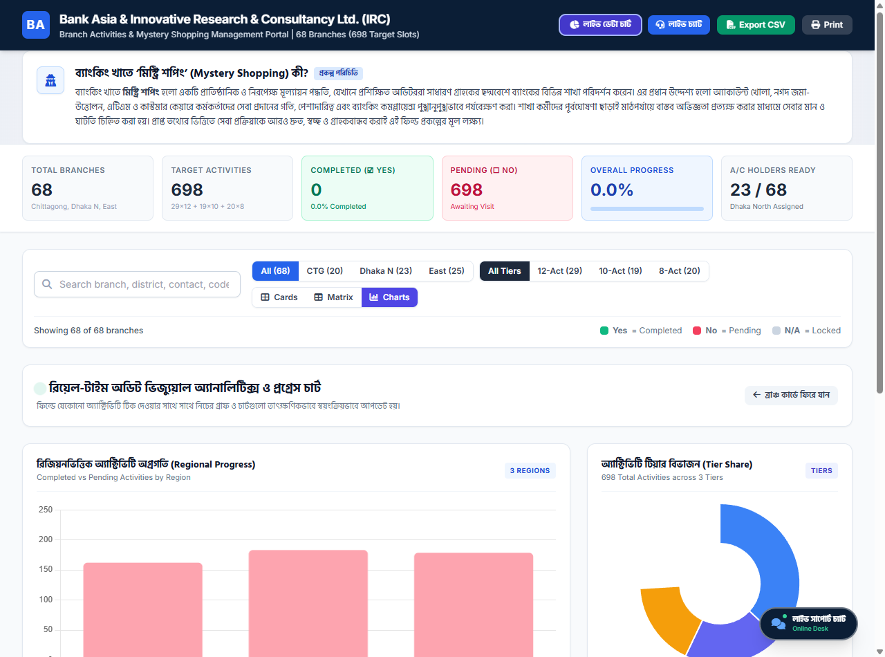
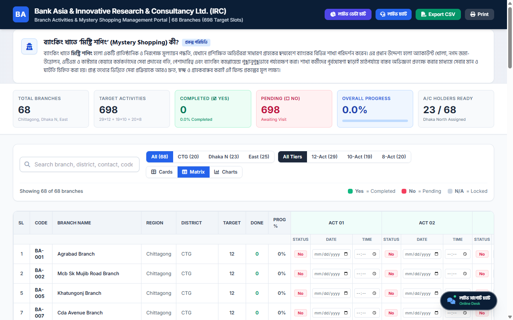

# 🏦 ব্যাংকিং খাতে মিস্ট্রি শপিং ও সার্ভে মানোন্নয়নে IRC-এর ভূমিকা
### Mystery Shopping in Banking & How IRC Enhances Bank Survey Quality & Standards

  
  
  
  
  

---

## 📸 সিস্টেম ড্যাশবোর্ড ইন্টারফেস (Interactive System Previews)

  
  <em>চিত্র ১: ৬৮টি শাখার ৬৯৮টি অ্যাক্টিভিটি ট্র্যাকার, রিয়েল-টাইম কেপিআই মেট্রিক্স এবং লাইভ সাপোর্ট চ্যাট ড্যাশবোর্ড।</em>

---

## 🔍 মিস্ট্রি শপিং (Mystery Shopping) কী?

**মিস্ট্রি শপিং (Mystery Shopping)** হলো একটি প্রাতিষ্ঠানিক, পদ্ধতিগত ও বৈজ্ঞানিক গবেষণা কৌশল—যার মাধ্যমে নিরপেক্ষ ও সুপ্রশিক্ষিত গবেষক বা অডিটররা সাধারণ গ্রাহকের ছদ্মবেশে কোনো আর্থিক প্রতিষ্ঠানের (যেমন: ব্যাংকের শাখা, এটিএম বুথ, হেল্পডেস্ক বা ডিজিটাল প্ল্যাটফর্ম) বিভিন্ন সেবা বাস্তবে গ্রহণ করেন এবং সেবার প্রতিটি স্তরের গুণমান, কার্যকারিতা, সময় এবং আচরণ পুঙ্খানুপুঙ্খভাবে পর্যবেক্ষণ ও মূল্যায়ন করেন।

### 📋 প্রথাগত অডিট বনাম মিস্ট্রি শপিংয়ের পার্থক্য

| অডিটের মানদণ্ড | প্রথাগত ইন্টারনাল অডিট (Internal Audit) | IRC মিস্ট্রি শপিং অডিট (Mystery Shopping) |
| :--- | :--- | :--- |
| **পরিদর্শনের ধরন** | পূর্বঘোষিত; শাখা কর্তৃপক্ষ অডিটরদের আগমন সম্পর্কে আগেই অবগত থাকে। | **১০০% গোপন ও পূর্বঘোষনাহীন**; সাধারণ গ্রাহকের ছদ্মবেশে পরিচালিত। |
| **মূল্যায়নের ভিত্তি** | নথিপত্র, ভাউচার ফাইল, লেজার বুক ও ব্যালেন্স শিট পরীক্ষণ। | **গ্রাহকের বাস্তব অভিজ্ঞতা**, সেবার আন্তরিকতা ও প্রত্যক্ষ কর্মতৎপরতা। |
| **কর্মীদের আচরণ** | কৃত্রিমভাবে অতিরিক্ত সতর্ক, নিয়ন্ত্রিত ও প্রস্তুত আনুষ্ঠানিক আচরণ। | **স্বাভাবিক, অকৃত্রিম ও প্রতিদিনের আসল আচরণ** ও প্রতিক্রিয়া। |
| **টার্নঅ্যারাউন্ড টাইম (TAT)** | আনুমানিক বা গড় হিসাব থেকে প্রাপ্ত তথ্য। | স্টপওয়াচ দিয়ে **কাউন্টার-টু-কাউন্টার সেকেন্ড-টু-সেকেন্ড সুনির্দিষ্ট সময়** লগ। |
| **সেবা পরিবেশ** | অডিটের দিন শাখা পরিষ্কার ও সুশৃঙ্খল রাখা হয়। | বুথের এসি, সিকিউরিটি গার্ডের সতর্কতা ও কাউন্টার ভিড়ের **আসল চিত্র** উন্মোচন। |
| **চূড়ান্ত ফলাফল** | কেবল অতীতের কমপ্লায়েন্স ও নিয়মের ত্রুটি-বিচ্যুতি শনাক্তকরণ। | **ভবিষ্যতের সেবার মানোন্নয়নে তথ্যভিত্তিক ও বাস্তবায়নযোগ্য কৌশলগত দিকনির্দেশনা**। |

---

## 🚀 কীভাবে IRC মিস্ট্রি শপিংয়ের মাধ্যমে ব্যাংক সার্ভের গুণমান ও নির্ভরযোগ্যতা বৃদ্ধি করে?

ব্যাংকিং সেক্টরে নির্ভুল গবেষণা, গ্রাহক সন্তুষ্টি পরিমাপ এবং কমপ্লায়েন্স নিশ্চিতে **Innovative Research & Consultancy Ltd. (IRC)** আধুনিক পদ্ধতি ও সুনির্দিষ্ট মেট্রিক্স প্রয়োগ করে ব্যাংক সার্ভের মান বহুগুণে বৃদ্ধি করে:

### ১. শতভাগ নিরপেক্ষ ও বাস্তব চিত্র উন্মোচন (100% Unbiased Ground-Truth Data)
প্রচলিত গ্রাহক মতামত জরিপে অনেক সময় গ্রাহকের ব্যক্তিগত পক্ষপাতিত্ব, অসচেতনতা বা অসম্পূর্ণ তথ্য থাকে। IRC-এর ফিল্ড অডিটররা প্রমিত স্কোরকার্ড ও আন্তর্জাতিক মানের গাইডলাইন অনুসরণ করে মাঠপর্যায় থেকে প্রমাণভিত্তিক (Voucher, SMS, টাইমস্ট্যাম্প ও অডিও-ভিজ্যুয়াল প্রুফ) ডেটা সংগ্রহ করে, যা সার্ভের ফলাফলের গ্রহণযোগ্যতা সর্বোচ্চ পর্যায়ে উন্নীত করে।

### ২. কর্মীদের পেশাদারিত্ব, আচরণ ও সেবার গতি পরিমাপ (Turnaround Time - TAT)
কাউন্টারে গ্রাহক দাঁড়ানোর পর থেকে সেবা শেষ হওয়া পর্যন্ত প্রতিটি ধাপের সময় (Start Time, End Time, Duration) সেকেন্ড-টু-সেকেন্ড ট্র্যাক করা হয়। একই সাথে কর্মকর্তাদের আচরণ কতটা আন্তরিক, তথ্য প্রদানের ক্ষেত্রে তারা কতটা সুস্পষ্ট এবং গ্রাহককে সঠিক দিকনির্দেশনা দিচ্ছেন কিনা—তা নির্ভুলভাবে পরিমাপ করা হয়।

### ৩. নিয়ন্ত্রক নীতিমালা ও কমপ্লায়েন্স (KYC / AML / SOP) বাস্তবায়ন যাচাই
বাংলাদেশ ব্যাংক এবং ব্যাংকের নিজস্ব পরিচালন নীতিমালা (SOP) অনুযায়ী গ্রাহকের পরিচয় যাচাই (KYC), প্রয়োজনীয় ডকুমেন্টস পরীক্ষণ, ফি ও চার্জের স্বচ্ছতা এবং গোপনীয়তা রক্ষা করা হচ্ছে কিনা—তা কোনো ব্যত্যয় ছাড়াই মূল্যায়ন করে IRC।

### ৪. শাখাভিত্তিক ও অঞ্চলভেদে সেবার ঘাটতি চিহ্নিতকরণ (Service Gap Analysis)
IRC-এর মেথডোলজির মাধ্যমে শহর, উপশহর ও প্রত্যন্ত অঞ্চলের শাখাগুলোর মধ্যে সেবার মানের তারতম্য চিহ্নিত করা যায়। যেমন: ঢাকা নর্থ, চট্টগ্রাম এবং ইস্ট রিজিয়নের ৬৮টি শাখার মাঝে কোন কোন শাখায় কাস্টমার কেয়ারে ঘাটতি রয়েছে তা সুনির্দিষ্ট ডেটা দ্বারা চিহ্নিত হয়।

### ৫. ওমনিচ্যানেল ও ডিজিটাল ব্যাংকিং সমন্বয় (Omnichannel Quality Assurance)
শুধু কাউন্টার ব্যাংকিংই নয়; এটিএম বুথের সচলতা, ক্যাশ প্রাপ্যতা, মোবাইল অ্যাপস ফান্ড ট্রান্সফার (BEFTN/NPSB/RTGS) এবং কাস্টমার কেয়ার হেল্পলাইনের সমন্বিত কার্যকারিতা একই ফ্রেমে এনে সার্ভে রিপোর্ট প্রস্তুত করা হয়।

### ৬. তথ্য-ভিত্তিক কৌশলগত সুপারিশ ও কর্মপরিকল্পনা প্রদান (Actionable Insights)
IRC কেবল সমস্যা চিহ্নিত করে ক্ষান্ত হয় না; বরং প্রাপ্ত ডেটার ওপর ভিত্তি করে ব্যাংকের শীর্ষ ব্যবস্থাপনাকে কর্মীদের সুনির্দিষ্ট ট্রেনিং মডিউল তৈরি, কাউন্টার ভিড় কমানোর প্রযুক্তিগত সমাধান এবং গ্রাহক সন্তুষ্টি বাড়াতে কার্যকর অ্যাকশন প্ল্যান প্রদান করে।

---

## 📊 প্রকল্পের ডেটা ও কাঠামোগত বণ্টন (Project Scope & Core Data)

### ১. অঞ্চলভিত্তিক শাখা ও কার্যক্রমের সারসংক্ষেপ (Regional Summary Table)

| অঞ্চল কোড | রিজিয়ন নাম | মোট শাখা | ৮-অ্যাক্টিভিটি ব্রাঞ্চ | ১০-অ্যাক্টিভিটি ব্রাঞ্চ | ১২-অ্যাক্টিভিটি ব্রাঞ্চ | মোট অডিট কার্যক্রম | অ্যাকাউন্ট হোল্ডার স্ট্যাটাস |
| :---: | :--- | :---: | :---: | :---: | :---: | :---: | :--- |
| **CTG** | চট্টগ্রাম রিজিয়ন (Chittagong) | **২০টি** | ৪টি (৩২ স্লট) | ৪টি (৪০ স্লট) | ১২টি (১৪৪ স্লট) | **২১৬টি** | ফিল্ড সমন্বয়কারী নির্ধারিত |
| **DHN** | ঢাকা নর্থ রিজিয়ন (Dhaka North) | **২৩টি** | ৩টি (২৪ স্লট) | ৫টি (৫০ স্লট) | ১৫টি (১৮০ স্লট) | **২৪৪টি** | **২৩/২৩ অ্যাকাউন্ট প্রস্তুত** (সম্পূর্ণ ভেরিফাইড) |
| **EAST** | ইস্ট রিজিয়ন (East Region) | **২৫টি** | ১৩টি (১০৪ স্লট) | ১০টি (১০০ স্লট) | ২টি (২৪ স্লট) | **২৩৮টি** | রোলআউট প্ল্যানার ও শিডিউল ম্যাপিং সম্পন্ন |
| **TOTAL** | **দেশব্যাপী সর্বমোট** | **৬৮টি** | **২০টি (১৬০)** | **১৯টি (১৯০)** | **২৯টি (৩৪৮)** | **৬৯৮টি** | **১০০% অডিট কাঠামো প্রস্তুত** |

---

### ২. অ্যাক্টিভিটি টিয়ার কাঠামো ও রাউন্ড বিন্যাস (Activity Tiers Matrix)

| টিয়ার ক্যাটাগরি | ব্রাঞ্চ সংখ্যা | রাউন্ড ১ (কোর ব্যাংকিং সেবা) | রাউন্ড ২ (ফলো-আপ ও ডিজিটাল সেবা) | মোট স্লট সংখ্যা | প্রযোজ্য শাখার ধরন |
| :--- | :---: | :--- | :--- | :---: | :--- |
| **Tier A (12-Act)** | **২৯টি শাখা** | Act 01 – Act 06 (ক্যাশ জমা/উত্তোলন, এটিএম, চেক, ফান্ড ট্রান্সফার) | Act 07 – Act 12 (কোয়েরি ডেস্ক, অ্যাপ, ২য় রাউন্ড লেনদেন, কার্ড ও রিকনসিলিয়েশন) | **৩৪৮টি স্লট** | প্রধান বাণিজ্যিক ও করপোরেট শাখা |
| **Tier B (10-Act)** | **১৯টি শাখা** | Act 01 – Act 05 (ক্যাশ জমা/উত্তোলন, এটিএম, চেক বই ও স্টেটমেন্ট) | Act 06 – Act 10 (ফান্ড ট্রান্সফার, কাস্টমার সার্ভিস, অ্যাপ ও ২য় রাউন্ড লেনদেন) | **১৯০টি স্লট** | মাঝারি ও উপশহর কেন্দ্রিক শাখা |
| **Tier C (8-Act)** | **২০টি শাখা** | Act 01 – Act 04 (ক্যাশ জমা/উত্তোলন, এটিএম লেনদেন ও চেক সার্ভিস) | Act 05 – Act 08 (স্টেটমেন্ট অনুসন্ধান, ফান্ড ট্রান্সফার, কাস্টমার সার্ভিস ও অ্যাপ) | **১৬০টি স্লট** | গ্রামীণ ও ক্ষুদ্র স্থানীয় শাখা |

---

### ৩. ১২টি স্বতন্ত্র ব্যাংকিং কার্যক্রমের বিশদ বিবরণী (12 Activities Breakdown)

| ক্রমিক | কার্যক্রমের নাম (Activity Title) | ব্যাংকিং চ্যানেল | ফিল্ড অডিট পর্যবেক্ষণ ও যাচাইযোগ্য নির্দেশকসমূহ | অন্তর্ভুক্তির পরিধি |
| :---: | :--- | :--- | :--- | :---: |
| **Act 01** | Counter Cash Deposit | ক্যাশ কাউন্টার | ক্যাশিয়ার কর্তৃক টাকা গ্রহণের গতি, জাল নোট শনাক্তকরণ, রসিদ প্রদান ও আচরণ। | সকল শাখা (12, 10, 8) |
| **Act 02** | Counter Cash Withdrawal | ক্যাশ কাউন্টার | চেক পাতা যাচাইয়ের সময়, ক্যাশ কাউন্টিং নিরাপত্তা, টোকেন সিস্টেম ও সেবার সময়। | সকল শাখা (12, 10, 8) |
| **Act 03** | ATM Booth Withdrawal / Balance | এটিএম বুথ | বুথ সচলতা, কার্ড আটকে যাওয়া প্রতিরোধ, ক্যাশ পর্যাপ্ততা, এসি ও গার্ডের ভূমিকা। | সকল শাখা (12, 10, 8) |
| **Act 04** | Cheque Book / Leaf Transaction | জেনারেল ব্যাংকিং | চেক বই রিকুইজিশন গ্রহণ, সময়মতো ইস্যু এবং জরুরি পাতা বরাদ্দে কর্মীদের সহযোগিতা। | সকল শাখা (12, 10, 8) |
| **Act 05** | Account Statement / Balance Inquiry | হেল্পডেস্ক | ব্যালেন্স স্টেটমেন্ট প্রদানে চার্জের স্বচ্ছতা, প্রিন্টিং গতি এবং গোপনীয়তা রক্ষা। | সকল শাখা (12, 10, 8) |
| **Act 06** | Fund Transfer (BEFTN / RTGS / NPSB) | রেমিট্যান্স ডেস্ক | ফান্ড ট্রান্সফার ফর্ম পূরণ সহজীকরণ, কাট-অফ সময় এবং এনপিএসবি রিয়েল-টাইম সহায়তা। | সকল শাখা (12, 10, 8) |
| **Act 07** | Customer Service / Query Desk | কাস্টমার রিলেশন | নতুন অ্যাকাউন্ট, ডিপিএস/এফডিআর বা ঋণের নিয়ম বোঝাতে কর্মীদের আন্তরিকতা ও ধৈর্য। | সকল শাখা (12, 10, 8) |
| **Act 08** | Mobile App / Digital Banking | ডিজিটাল প্ল্যাটফর্ম | ব্যাংক এশিয়া অ্যাপে ফান্ড ট্রান্সফার, ওটিপি প্রেরণের গতি ও ইউজার ইন্টারফেস সহায়তা। | সকল শাখা (12, 10, 8) |
| **Act 09** | Counter Deposit (Round-2) | ফলো-আপ কাউন্টার | দ্বিতীয় দফায় ভিজিটের সময় পূর্বের অভিজ্ঞতার সাথে সামঞ্জস্য ও সেবার মান ধারাবাহিকতা। | Tier A (12) ও Tier B (10) |
| **Act 10** | Counter Withdrawal (Round-2) | ফলো-আপ কাউন্টার | দ্বিতীয় দফার ক্যাশ উত্তোলনে টার্নঅ্যারাউন্ড টাইম (TAT) ও গ্রাহক হ্যান্ডলিং দক্ষতা। | Tier A (12) ও Tier B (10) |
| **Act 11** | Card / Cheque Service Follow-up | কার্ড ডিভিশন | ডেবিট কার্ড এক্টিভেশন, গ্রিন পিন তৈরি, এসএমএস অ্যালার্ট ও হেল্পলাইন সমন্বয়। | শুধু Tier A (12-Act) |
| **Act 12** | Final Account Reconciliation Visit | ব্রাঞ্চ ম্যানেজমেন্ট | হিসাব সমাপ্তি, চূড়ান্ত ব্যালেন্স মিলকরণ, ফিল্ড অডিট লগ নিশ্চিতকরণ ও ফিডব্যাক। | শুধু Tier A (12-Act) |

---

## 📈 ভিজ্যুয়াল অ্যানালিটিক্স ও ইন্টারফেস গ্যালারি (Visual Analytics & Matrix Gallery)

  
  <em>চিত্র ২: রিয়েল-টাইম ডেটা চার্ট ড্যাশবোর্ড (রিজিয়নাল প্রগ্রেস স্ট্যাকড চার্ট, টিয়ার ডোন্ট ও ১২টি চ্যানেলের পৃথক সমাপ্তি হার)।</em>

  
  <em>চিত্র ৩: ৬৮টি শাখার ৬৯৮টি কার্যক্রমের মাস্টার হরিজন্টাল ম্যাট্রিক্স ভিউ (লাইভ টিকবক্স ও ইন্ডিভিজুয়াল ডেট-টাইম লগ)।</em>

---

## ⚡ সিস্টেমের মূল কারিগরি বৈশিষ্ট্যসমূহ (Technical Features)

- **ইন্টারেক্টিভ হ্যাঁ/না চেকবক্স:** প্রতিটি ব্রাঞ্চের বরাদ্দকৃত প্রতিটি কার্যক্রমের জন্য স্পষ্ট `☑ Yes` এবং `☐ No` বাটন।
- **স্বতন্ত্র তারিখ ও সময় ট্র্যাকিং:** প্রতিটি অ্যাক্টিভিটির জন্য আলাদা `Date Picker` এবং `Time Picker` লগিং।
- **রিয়েল-টাইম কেপিআই মেট্রিক্স:** মোট শাখা (৬৮), টার্গেট অ্যাক্টিভিটি (৬৯৮), সম্পন্ন সংখ্যা ও শতকরা (%) হার স্বয়ংক্রিয় হিসাব।
- **লাইভ চার্ট অ্যানালিটিক্স (Chart.js):** ফিল্ডে টিক দেওয়ার সাথে সাথে গ্রাফগুলো পেজ রিফ্রেশ ছাড়াই আপডেট হয়।
- **অটোমেটেড লাইভ সাপোর্ট চ্যাট ডেস্ক:** অ্যাকাউন্ট খোলার ডকুমেন্টস, ফি ও চার্জ, ঋণ সুবিধা এবং সমন্বয়কারীদের তাৎক্ষণিক তথ্য প্রদানকারী ভার্চুয়াল ডেস্ক।
- **অফলাইন ডেটা সুরক্ষা:** ব্রাউজারের `localStorage` মেকানিজমে ডেটা সংরক্ষিত থাকে; ইন্টারনেট সংযোগ ব্যাহত হলেও ডেটা মুছে যায় না।
- **ওয়ান-ক্লিক সিএসভি ও এক্সেল এক্সপোর্ট:** অডিট রিপোর্ট সেকেন্ডের মধ্যে ডাউনলোড করে অফলাইনে স্প্রেডশিটে ব্যবহারের সুবিধা।

---

## 📄 License & Credits

- **Client / Organization:** Innovative Research & Consultancy Ltd. (IRC)
- **Partner Institution:** Bank Asia
- **Author:** Monour Hosan Saif ([@monourhosan](https://github.com/monourhosan))
- **License:** MIT
